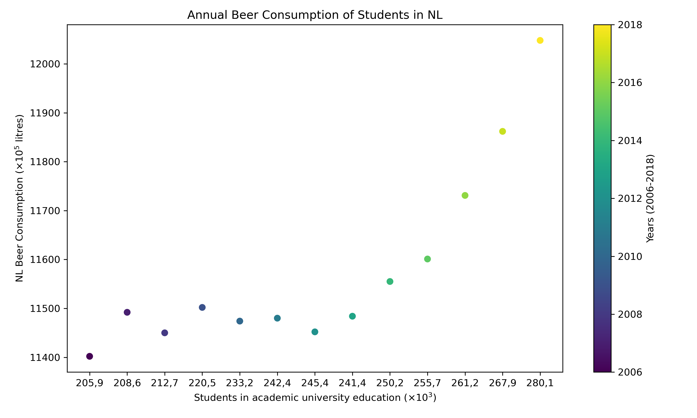

14211912
MCC Van Dyke et al., 2019
JT Harvey, Applied Ergonomics, 2002
DW Ziegler et al., 2005

This data shows that over time more Dutch students consume beer than in prior years. This would suggest that there could be another factor that contributes to this pattern, like study association sponsorhsip by Heineken etc. However, correlation isn't necessarily causation. 